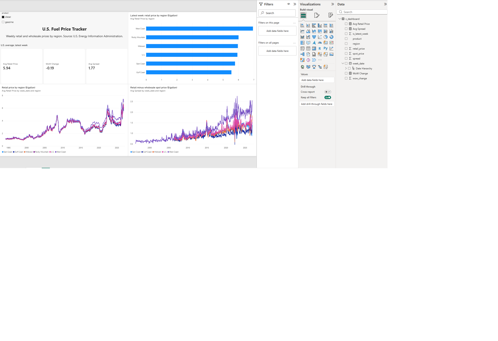

# U.S. Fuel Price Tracker

A small analytics project that tracks weekly U.S. retail gasoline and diesel prices by region, compares them with wholesale (spot) benchmarks, and presents the results in a one-page Power BI dashboard.

It is built on public data from the U.S. Energy Information Administration (EIA), stored in a SQLite database, queried with SQL, and prepared with R.

*The screenshot shows data through the week of November 16, 2026.*

## What the dashboard shows

- **Retail price by region:** weekly prices for the U.S. average and five regions (East Coast, Midwest, Gulf Coast, Rocky Mountain, West Coast).
- **Retail minus wholesale spread:** the gap between each region's retail price and its benchmark spot price.
- **Latest week by region:** a ranking of regional prices for the most recent week.
- **Summary cards:** the U.S. average price, its week-over-week change, and its spread for the latest week.
- **Product slicer:** switches every visual between diesel and gasoline.

## Data

| Table | Contents | Source |
|---|---|---|
| `retail_prices` | Weekly retail prices by area and product (about 58,000 rows; gasoline from 1990, diesel from 1994) | EIA Gasoline and Diesel Fuel Update |
| `spot_prices` | Weekly spot prices at New York Harbor, the Gulf Coast, and Los Angeles (about 8,800 rows) | EIA Spot Prices |
| `regions` | Lookup table that assigns each region a benchmark spot hub | Defined in `fuel_project.R` |

Sources:

- EIA Gasoline and Diesel Fuel Update: https://www.eia.gov/petroleum/gasdiesel/
- EIA Spot Prices: https://www.eia.gov/dnav/pet/pet_pri_spt_s1_w.htm

## Files

| File | Purpose |
|---|---|
| `fuel_project.R` | Downloads the EIA workbooks, reshapes them to long format, builds the SQLite database, creates the views, and exports the dashboard table |
| `views.sql` | Defines the three SQL views behind the dashboard |
| `queries.sql` | Analysis queries: filtering, aggregation, joins, a window function, and a CTE with ranking |
| `dashboard.png` | Screenshot of the Power BI dashboard |

The data files and the database are not stored here, because the script rebuilds them.

## How to run it

1. Install R and the packages `readxl`, `dplyr`, `tidyr`, `DBI`, and `RSQLite`.
2. Put `fuel_project.R` and `views.sql` in one folder and run `source("fuel_project.R")` from that folder. This creates `fuel.sqlite` and `v_dashboard.csv`.
3. Open `fuel.sqlite` in any SQLite client (for example, DB Browser for SQLite) to run `queries.sql`.
4. In Power BI Desktop, load `v_dashboard.csv` to rebuild or refresh the dashboard.

## SQL highlights

- **Date alignment in a join.** EIA dates retail prices on Mondays, while weekly spot averages end on Fridays. The spread query matches each retail price to the spot price dated three days earlier.
- **Window function.** `LAG() OVER (PARTITION BY region, product ORDER BY week_date)` calculates the week-over-week change for each series.
- **Inner versus left join.** The spread view uses an inner join, so it keeps only regions with a benchmark hub. The dashboard view uses a left join, so regions and weeks without a benchmark stay in the price charts.

## Limitations

- **The spread is not a retail margin.** Retail prices include taxes, and the gap between retail and spot prices also covers distribution and marketing costs.
- **The benchmark mapping is a simplification.** The U.S. average and the Midwest are compared with the Gulf Coast hub, and the Rocky Mountain region has no benchmark assigned.
- **Regional averages hide local variation.** EIA publishes prices for regions, a few states, and a few cities, not for individual stations.

## Author

Mohammad Khayat Sarkar, Ph.D. candidate in Economics, University of Oklahoma
